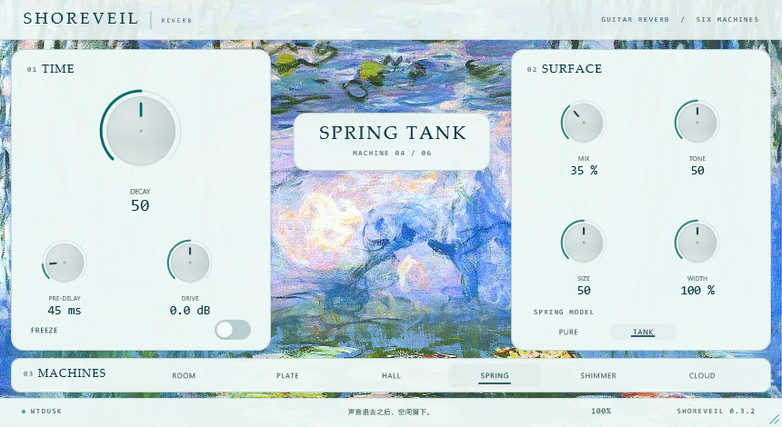

# Shoreveil Reverb · 岸雾混响

[](LICENSE)

Shoreveil Reverb is a six-mode algorithmic reverb for electric guitar, built
with JUCE. Its modes range from close room reflections and spring dispersion
to long shimmer and cloud tails.

岸雾混响是一款面向电吉他的算法混响，提供六种模式、冻结尾音和自由缩放界面。
当前 Windows x64 版本为 **0.3.2**。仓库及下载需要 GitHub 仓库访问权限。




## Download and install · 下载与安装

See the [v0.3.2 release](https://github.com/WTdusk/Shoreveil-Reverb/releases/tag/v0.3.2)
for the Windows x64 VST® 3 installer, portable ZIP, and matching source archive.
The release lists SHA-256 checksums. The Windows installer and plug-in are unsigned.

- **Installer · 安装包** — Close the DAW, run the installer, and rescan plug-ins.
  The default location is `C:\Program Files\Common Files\VST3` and requires
  administrator privileges.
- **Portable · 便携版** — Extract the ZIP and copy the entire
  `Shoreveil Reverb.vst3` bundle into a folder your DAW scans. For a per-user
  installation, use `%LOCALAPPDATA%\Programs\Common\VST3` if your host scans it.
- **Corresponding source · 对应源码** — Download the source ZIP beside the
  binary. It contains the project, build and packaging scripts, and JUCE 9.0.5
  for offline builds.

## Sound and controls · 声音与控件

| Mode | Character |
| --- | --- |
| Room | Early reflections and low-frequency room modes |
| Plate | Dense reflections with a fixed high-frequency sheen |
| Hall | Progressive diffusion that thickens the tail |
| Spring | **Pure** for the linear tank or **Tank** for a level-dependent physical model with Drive |
| Shimmer | Octave-up feedback in a diffused hall |
| Cloud | Slowly modulated delay chains for a drifting tail |

- Mix, Decay, Pre-Delay, Tone, Mod, Size, and Width shape the reverb. In Spring
  mode, the Mod control becomes Drive.
- Freeze holds the current wet tail and rejects new input. Hosts that stop
  rendering at the reported 60-second tail may truncate a frozen tail.
- Drag the bottom-right corner for **65%–200%** proportional resizing. The
  footer displays the current zoom, and the editor remembers its size on the
  same plug-in instance.
- Supported layouts are mono-to-mono, mono-to-stereo, and stereo-to-stereo.
  The plug-in adds no latency.
- Rapid changes among several modes can interrupt a still-fading tail. A local
  stress test also found missed block deadlines at 96 kHz with a 32-sample
  buffer. See [the diagnostic](tools/analyzer/SwitchStress.h).

## Build and test · 构建与测试

Use CMake 3.22 or newer and a C++17 toolchain. From a Visual Studio developer
shell on Windows, configure the pinned JUCE download and build the VST3.

```powershell
cmake -S . -B build -A x64 -DRIVAGE_FETCH_JUCE=ON
cmake --build build --config Release --target ShoreveilReverb_VST3
```

[Build instructions](BUILDING.md) cover offline setup, other platforms,
packaging, and signing. [DSP notes](docs/BEHAVIOUR_FIXES.md) document the
Freeze and Cloud changes. [Measurement tools](tools/analysis/README.md)
cover rendering and regression analysis.

The Windows workflow builds the plug-in and tools, runs the smoke renders,
and checks channel layouts, state restore, hosted offline Freeze, and DSP
behavior. See the [changelog](CHANGELOG.md) for version history.

## License · 许可证

[AGPL-3.0-or-later](LICENSE). See [third-party notices](THIRD-PARTY.md).

VST is a registered trademark of Steinberg Media Technologies GmbH.

Copyright © 2026 WTdusk.
